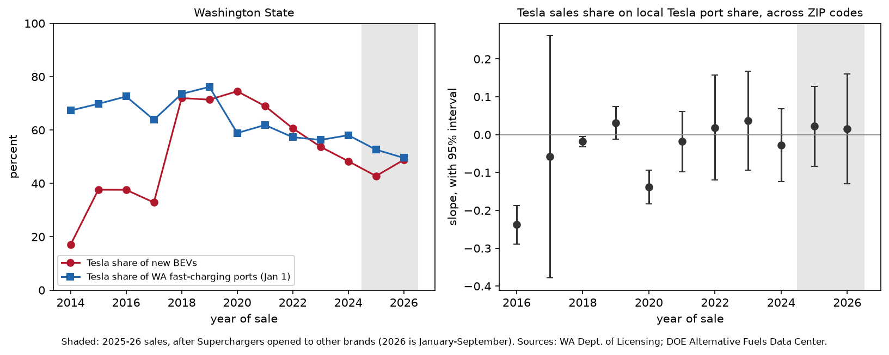
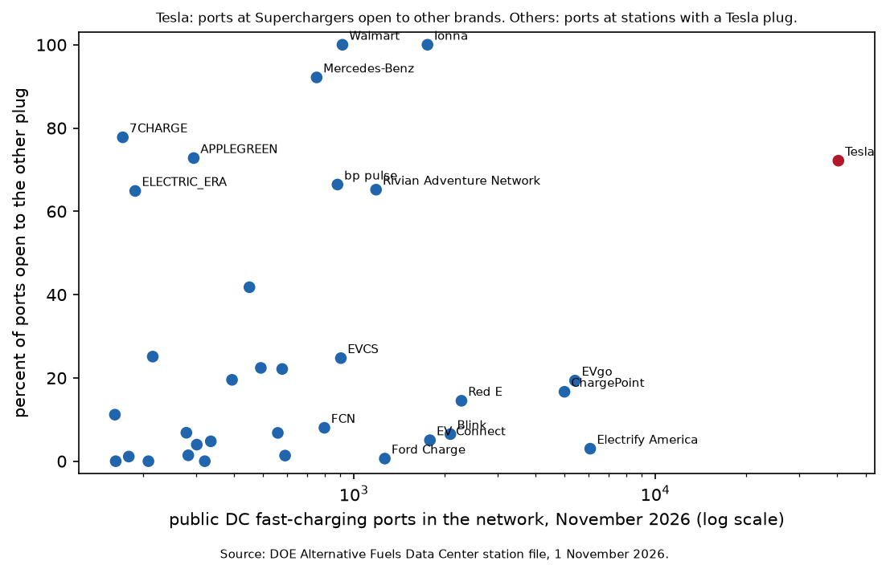

# The Supercharger Moat

### In 1985, Michael Katz and Carl Shapiro asked whether the biggest network wins because it is the biggest, and whether it will ever agree to share. I asked again, with every new battery-electric car sold in Washington State and every public fast charger in the country.

---

Ellensburg, Washington, sits on Interstate 90 on the dry side of the Cascades, and on December 23, 2013, Tesla opened a five-stall Supercharger there. For the next seven years it was the only public fast charger in town listed in the Department of Energy's station file, and only a Tesla could plug into it. In December 2020 Electrify America put four fast chargers behind a Taco Bell. Today the town has an eight-port EVgo site at a Flying J, a Rivian station, an Ionna station at a Circle K, a single ChargePoint port, and two newer Superchargers, a 12-stall site on Canyon Road and a 16-stall site at Fred Meyer. The Canyon Road site now carries the note "NACS partner enabled," which means a Ford, a Hyundai or a Rivian can charge there too. The original five stalls from 2013 still say "Open to Teslas only."

In 2019, every one of the seven new battery-electric cars titled in Ellensburg's ZIP code was a Tesla. In 2025 it was 20 of 57.

The question behind those numbers is one of the oldest in the economics of technology. When the value of a product depends on how many other people use it, or on the size of the network of chargers, apps or service shops behind it, the company with the biggest network may win simply because it is biggest, and it may never let rivals plug in. Michael Katz and Carl Shapiro gave the modern answer in 1985, and the American charging network has spent the last four years running their experiment.

---

## Two measures

The first measure describes the local charging network. For a ZIP code $`z`$ on January 1 of year $`t`$, I count the public DC fast-charging ports within 25 kilometers of the ZIP's center, and take the Tesla share:

```math
\begin{aligned}
T_{z,t} &= \frac{\text{Tesla Supercharger ports within 25 km}}{\text{all public fast-charging ports within 25 km}} \\
s_{z,t} &= \frac{\text{new Teslas titled in } z \text{ in year } t}{\text{all new battery-electric cars titled there}}
\end{aligned}
```

The second measure, $`s_{z,t}`$, is Tesla's share of the new battery-electric cars sold there that year. For Ellensburg (ZIP 98926) on January 1, 2022, the five original Supercharger stalls and Electrify America's four ports were the whole local network, and 18 of the 43 new battery-electric cars titled there that year were Teslas.

```math
T_{98926,\,2022} = \frac{5}{5 + 4} = 0.556, \qquad s_{98926,\,2022} = \frac{18}{43} = 0.419
```

Three years earlier the same calculation gave $`T = 5/5 = 1.0`$ and $`s = 7/7 = 1.0`$. The measure runs between two extremes.

| Tesla share of nearby fast ports | What a non-Tesla driver finds within 25 km | Example |
|---|---|---|
| 0 | Fast chargers, none of them Tesla's | Kelso (98632) in January 2019, with 2 ports |
| 0.5 | Half the fast ports are behind a Tesla plug | Kelso in January 2025, 12 Tesla and 12 others |
| 1 | Every fast charger is a Tesla Supercharger | Ellensburg in January 2019 |

When $`T`$ is 1 and Superchargers are closed to other brands, a buyer who wants to fast-charge nearby has exactly one choice of brand.

---

## Katz and Shapiro's question

Michael Katz and Carl Shapiro were young economists at Princeton when they wrote "Network Externalities, Competition, and Compatibility," published in the *American Economic Review* in June 1985. Katz, an Oxford PhD, was an assistant professor there and moved to Berkeley in 1987. Shapiro, an MIT PhD of 1981, taught at Princeton through the 1980s and joined Berkeley in 1990. Both later ran economic analysis at the Justice Department's Antitrust Division, Katz from 2001 to 2003 and Shapiro twice, and Shapiro served on the President's Council of Economic Advisers in 2011 and 2012.

Their paper starts from the observation that for many products the value to one user rises with the number of other users. Sometimes the effect is direct, as with a telephone. Sometimes it runs through a complementary good, as when more buyers of a computer bring more software for it. Charging stations for electric cars are the second kind. Katz and Shapiro built a model in which buyers care about the size of the network they expect a brand to have, sellers compete by choosing how much to produce, and in equilibrium buyers' expectations turn out to be right.

In the version of their model I use here, a buyer with basic taste $`r`$ for the good values brand $`i`$ at $`r + v(N_i)`$, where $`N_i`$ is the network that brand's owners expect to reach and $`v`$ rises with it. Tastes are spread evenly with density one up to a ceiling $`A`$, each of $`n`$ sellers produces $`x_i`$ cars at unit cost $`c`$, total output is $`z`$, and each seller picks its output taking the expected networks as given. Every brand that sells must offer buyers the same price net of network value, and the seller's first-order condition does the rest.

```math
\begin{aligned}
p_i - v(N_i) &= p_j - v(N_j) = A - z && \text{(the marginal buyer is indifferent among brands)}\\
\pi_i &= \big(A + v(N_i) - z - c\big)\,x_i, \qquad z = \textstyle\sum_j x_j \\
\frac{\partial \pi_i}{\partial x_i} &= A + v(N_i) - z - c - x_i = 0 \\
x_i - x_j &= p_i - p_j = v(N_i) - v(N_j) \\
z &= \frac{n(A-c) + \sum_i v(N_i)}{n+1}
\end{aligned}
```

In plain English, when networks are incompatible the brand whose buyers can reach the bigger network sells more and charges more, each by exactly the value of the extra network, and making networks compatible gives every brand's buyers the whole network, which erases the size advantage and raises the number of cars sold.

From this Katz and Shapiro drew the conclusions the paper is remembered for. Industry output is greater under compatibility than in any equilibrium where some firms are incompatible. Firms with large networks or good reputations tend to be biased against compatibility, and firms with small networks or weak reputations tend to favor it. The private and social incentives to become compatible can differ in either direction, so the market can end up with too little compatibility or too much.

The strongest objection came in 1994 from Stan Liebowitz and Stephen Margolis, who argued in the *Journal of Economic Perspectives* that network effects are real but that true network externalities, the market failures the theory warns about, are theoretically fragile, poorly documented, and often merely pecuniary, working through prices rather than around them. Katz and Shapiro's own survey in the same issue argued that a firm confident of winning under incompatibility will tend to oppose compatibility, and that side payments between firms make it more likely that they settle on the arrangement that maximizes their joint profits. The question still matters because nearly every modern platform, from phone operating systems to payment networks, faces the same choice about whether to let rivals' customers in.

Tesla made that choice in public. On November 11, 2022, it published the design of its charging connector and invited other carmakers and charging networks to use it, calling it the North American Charging Standard. Ford, the first carmaker to sign on, in May 2023, began giving its owners Supercharger access with an adapter on February 29, 2024. Press coverage of the launch reported that the adapter worked only at newer, third-generation stations and that Tesla was keeping some locations exclusive to Tesla drivers.

---

## How I tested it

Washington's Department of Licensing publishes every title and registration transaction for electric vehicles in the state. I counted the first titles on new battery-electric cars, which are sales, by ZIP code, year and make for 2016 through September 2026, a total of 242,996 cars in ZIP codes with a Census location. For chargers I used the Department of Energy's Alternative Fuels Data Center station file downloaded on November 1, 2026, which lists 16,460 public DC fast-charging stations nationwide with their network, connector types, number of ports and opening date. I placed each Washington ZIP at its Census 2020 center point and computed $`T_{z,t}`$ from every station within 25 kilometers that had opened by January 1 of the year. ZIP-years with no fast charger nearby have no defined $`T`$ and are left out, which drops 1,227 small ZIP-years.

Katz and Shapiro's model is about firms and networks in general, so the rules here are mine, set before I looked at results. I split the years into three periods, before compatibility from 2016 to 2022, a transition in 2023 and 2024 between Tesla's announcement and broad access, and after compatibility in 2025 and 2026. Then I estimated

```math
\begin{aligned}
s_{z,t} &= \alpha_z + \gamma_t + \beta_{\text{pre}}\, T_{z,t}\,\mathbf{1}[t \le 2022] \\
&\quad + \beta_{\text{tr}}\, T_{z,t}\,\mathbf{1}[2023 \le t \le 2024] + \beta_{\text{post}}\, T_{z,t}\,\mathbf{1}[t \ge 2025] + \varepsilon_{z,t} \\
\text{model: } &\ \beta_{\text{pre}} > 0, \qquad \beta_{\text{post}} - \beta_{\text{pre}} < 0
\end{aligned}
```

where $`\alpha_z`$ is a ZIP fixed effect that absorbs everything permanent about a place, from income to commuting distance, and $`\gamma_t`$ is a year effect that absorbs statewide swings in Tesla's popularity, prices and tax credits. Each ZIP-year is weighted by its number of new battery-electric cars. Standard errors are clustered by county, because ZIPs within 25 kilometers of each other share chargers. The model says $`\beta_{\text{pre}}`$ should be positive, because before 2023 a bigger local Supercharger share was a bigger network that only Tesla buyers could use, and that $`\beta_{\text{post}}`$ should fall toward zero once other brands could use it too. I also tried radii of 10 and 50 kilometers, dropped 2026 and small ZIP-years, removed the weights, and compared ZIPs with each other instead of with themselves.

---

## Teslas did not cluster where the Superchargers were

Before compatibility, Washington buyers chose Teslas at almost the same rate whether or not the local fast-charging network belonged to Tesla.

| 2016 to 2022 | ZIP-years | New battery-electric cars | Tesla share |
|---|---|---|---|
| No Tesla ports nearby, only others | 669 | 13,196 | 61% |
| Tesla has 1% to 40% of nearby ports | 111 | 5,102 | 68% |
| 40% to 60% | 401 | 37,125 | 67% |
| 60% to 80% | 234 | 10,842 | 69% |
| 80% to 100% | 214 | 6,557 | 69% |

Places where every nearby fast charger was someone else's still bought Teslas 61% of the time. Places where nearly every fast charger was a Supercharger bought them 69% of the time. Following the same ZIP codes over time, as the local network shifted toward or away from Tesla, gives a slope that is, if anything, slightly negative.

```math
\begin{aligned}
\hat{\beta}_{\text{pre}} &= -0.039\ (0.020), \qquad 95\%\ \text{CI}\ [-0.078,\ -0.000] \\
N &= 3{,}085 \text{ ZIP-years in } 434 \text{ ZIPs and } 37 \text{ counties}
\end{aligned}
```

A typical within-ZIP swing in $`T`$ was 0.21, so the estimate says a ZIP whose network tilted that far toward Tesla saw Tesla's share move by less than one percentage point, and in the wrong direction. The interval rules out the positive slope the model predicts. With a 10-kilometer radius the estimate is 0.009 (0.011), and with 50 kilometers it is 0.035 (0.020), neither significant at the 5% level.

Ellensburg shows why. Its local network went from all Tesla in 2019 to a little more than half Tesla by 2022, and Tesla's share of its new cars fell from 100% to 42%, the direction the model predicts. Downtown Seattle (98101) had a network that was 62% Tesla in 2019 and 49% in 2022, while Tesla's share of its new cars stayed above 80%. Across 434 ZIP codes these cases cancel out. The charging network that matters to a Washington buyer seems not to be the one within 25 kilometers of home but the statewide network along the highways, which is the same for everyone in the state.



In the left panel the two statewide lines move together. Tesla held 74% of Washington's fast-charging ports on January 1, 2018, and sold 72% of the state's new battery-electric cars that year. By January 2026 its share of ports had fallen to 50%, and in January through September 2026 it sold 49% of the new cars. The right panel repeats the cross-ZIP comparison one year at a time. No year shows the clear positive slope the model predicts.

---

## Opening the network moved the state, not the neighborhood

After Superchargers opened to other brands, the local link stayed flat, and the statewide picture changed a great deal.

```math
\begin{aligned}
\hat{\beta}_{\text{post}} &= -0.064\ (0.029) \\
\hat{\beta}_{\text{post}} - \hat{\beta}_{\text{pre}} &= -0.025\ (0.025), \qquad p = 0.32, \qquad N = 3{,}085
\end{aligned}
```

The difference has the sign the model predicts, but it is small and could easily be chance, and there was no positive slope to lose in the first place. The output prediction fares no better. Non-Tesla sales grew a little faster after 2024 in ZIPs where Tesla had held more of the local network, by 0.11 log points (0.21) per unit of $`T`$, too imprecise to read either way. At a 50-kilometer radius, the one version where the before-slope is positive, the drop is larger, −0.113 (0.044) with p = 0.01, which is the pattern the model predicts. It does not appear at 10 or 25 kilometers.

Statewide, the market Tesla used to dominate has filled with rivals.

| Brand | New battery-electric cars, 2018 to 2022 | Share | New battery-electric cars, 2025 to Sept. 2026 | Share |
|---|---|---|---|---|
| Tesla | 48,961 | 67.5% | 32,163 | 45.1% |
| Hyundai | 1,142 | 1.6% | 4,851 | 6.8% |
| Ford | 2,166 | 3.0% | 4,350 | 6.1% |
| Rivian | 992 | 1.4% | 3,951 | 5.5% |
| Chevrolet | 4,445 | 6.1% | 3,722 | 5.2% |
| Kia | 2,875 | 4.0% | 3,535 | 5.0% |
| Toyota | 3 | 0.0% | 2,173 | 3.0% |
| Nissan | 5,240 | 7.2% | 1,653 | 2.3% |

Hyundai and Rivian roughly quadrupled their shares and Ford doubled its own, and drivers of all three gained Supercharger access between early 2024 and early 2025. That is what Katz and Shapiro's model predicts when a big network opens, but the table cannot separate the opening from everything else that happened at the same time. Toyota, Honda, Cadillac and Subaru, which together sold 27 battery-electric cars in Washington from 2018 to 2022, sold 8,042 from 2025 through September 2026. The federal tax credit also ended on September 30, 2025. The ZIP-level test was built to see through those statewide changes, and at that level it finds no effect of the opening. Comparing ZIPs with each other instead of with themselves gives a slope that turns positive after the opening, 0.127 (0.034) in 2025 and 2026, the opposite of the model's prediction.

---

## The biggest network opened most of its doors

Katz and Shapiro's best-known prediction concerns the choice itself, that the firm with the large network resists compatibility and the small firms seek it. Tesla runs 40,504 of the 80,930 public fast-charging ports in the country, half of the total. On November 1, 2026, 72% of the Supercharger ports with an access note in the federal file were open to other brands.

| Network | Public fast ports | Share of US ports | Open to the other plug |
|---|---|---|---|
| Tesla | 40,504 | 50.0% | 72% of ports open to non-Teslas |
| Electrify America | 6,081 | 7.5% | 3% at stations with a Tesla plug |
| EVgo | 5,414 | 6.7% | 19% |
| ChargePoint | 4,996 | 6.2% | 17% |
| Ionna | 1,754 | 2.2% | 100% |
| Ford Charge | 1,266 | 1.6% | 1% |
| Rivian Adventure Network | 1,184 | 1.5% | 65% |
| Walmart | 916 | 1.1% | 100% |
| bp pulse | 882 | 1.1% | 66% |
| Mercedes-Benz | 752 | 0.9% | 92% |

Among the other networks, size tells little about who added Tesla-style plugs. Ionna, the venture of eight automakers including BMW, GM, Hyundai and Toyota, put the Tesla plug at every station, and Walmart put both plugs at every station. Holding the opening year fixed, a station's chance of having the Tesla plug barely changes with the size of its network, by −0.006 (0.013) per log point across 12,615 stations in 75 networks. What predicts a Tesla plug is how recently the station was built. Of rival stations opened in 2022, 8.5% have one, and of those opened in 2026, 38.5%.



Inside Tesla the pattern is sharper and runs against the simplest reading of the theory. The stations Tesla built before 2020, mostly older hardware that the Ford adapter could not use, are almost all closed, 713 of 726. Among the 2,228 stations opened from 2020 through 2025, 90.5% are open, rising from 71% of those built in 2020 to 99% of those built in 2025. For those stations I estimated

```math
\begin{aligned}
\text{open}_s &= \theta \ln(1 + R_s) + \lambda \ln(\text{stalls}_s) + \mu_{\text{year}(s)} + \eta_{\text{state}(s)} + u_s \\
\hat{\theta} &= -0.023\ (0.005), \qquad 95\%\ \text{CI}\ [-0.033,\ -0.012], \qquad N = 2{,}228
\end{aligned}
```

where $`R_s`$ is the number of rival fast-charging ports within 25 kilometers, with errors clustered by state. A Supercharger with 141 rival ports nearby, the average for stations where Tesla holds less than half of local fast charging, is about $`0.023 \times \ln 142 \approx 0.11`$, or 11 percentage points, less likely to be open than one with no rival nearby. The stations Tesla kept exclusive lean toward the places where it faces the most competition, while it opened 96% of the 92 stations with no rival within 25 kilometers. Measured by its local share of fast charging, the coefficient is positive, 0.046 (0.031), not the negative sign the simplest version of the theory predicts.

That fits the side-payment logic in Katz and Shapiro's own later account better than the textbook prediction. A network that can charge outsiders for access does not need exclusivity to profit from its size. One reading is that Tesla sells access where it has no rival and protects its own drivers' waiting times where everyone else has alternatives.

---

## Why it matters

For drivers, the practical effect of compatibility is already large. A Ford or Hyundai owner in Washington in 2019 faced a fast-charging network that was three-quarters closed to them, and today most Supercharger ports in the country are open. The data do not show that the old exclusivity steered people's choice of car at the local level, which suggests buyers judged the network as a whole.

For rival carmakers, the episode shows the small-network side of Katz and Shapiro's prediction working as described. Ford, GM, Hyundai, Rivian and others chose to adopt the larger network's plug rather than hold out for their own, and Hyundai, Ford and Rivian grew. The data cannot settle whether access caused the growth.

For the networks, the result is the more surprising one. The largest network has opened most of its stations in the four years since it published its plug, and among the others size made no systematic difference. Katz and Shapiro's 1994 survey points out that when firms can pay each other, they tend to settle on whatever arrangement maximizes their joint profits, and a network that collects a charging fee from every outside driver is in that position.

For policy, the lesson is about what to watch. Katz and Shapiro were right that a large network decides on compatibility for its own reasons. Here those reasons led toward opening the network, with exceptions at the most contested sites. A regulator worried about exclusivity would learn more from where the remaining closed stations are than from the share that is open.

---

## Limits of this study

The station file lists stations that exist today, so chargers that opened and later closed are missing, and the network in early years is slightly understated. Washington is one state with high Tesla ownership, much home charging and a particular political climate, so the local test may not carry to Texas or Georgia. A ZIP code is a coarse unit, and 25 kilometers is my choice of local market. A 10-kilometer radius gives the same answer, but at 50 kilometers the drop after compatibility is significant, so the null depends partly on how a local market is drawn. The test measures where cars are titled, not where they charge, and it cannot see the adapters that let Teslas use rivals' stations, which make the pre-2023 networks less exclusive than my measure assumes. The access notes are a snapshot of November 2026, so I cannot date when each Supercharger opened to other brands. Above all, these are associations. Tesla built Superchargers where it expected demand, and no part of this design settles what caused what.

---

## Further reading

- [TECHNICAL.md](TECHNICAL.md) covers the data files, the rules fixed before seeing results, every test statistic, and how to reproduce the analysis.
- [results/FINDINGS.md](results/FINDINGS.md) has a plain-English summary and every table the scripts produce.
- [METHODS_REVIEW.md](METHODS_REVIEW.md) is a methods and reporting review of the original paper.
- The original paper is Michael L. Katz and Carl Shapiro, "Network Externalities, Competition, and Compatibility," *American Economic Review* 75(3), June 1985, pp. 424–440. Their later survey is "Systems Competition and Network Effects," *Journal of Economic Perspectives* 8(2), 1994, pp. 93–115.
- The objection is Stan J. Liebowitz and Stephen E. Margolis, "Network Externality: An Uncommon Tragedy," *Journal of Economic Perspectives* 8(2), 1994, pp. 133–150.
- Sales come from the Washington State Department of Licensing, Electric Vehicle Title and Registration Activity (data.wa.gov, dataset rpr4-cgyd), through September 30, 2026, downloaded November 1, 2026.
- Charging stations come from the US Department of Energy Alternative Fuels Data Center station file (developer.nlr.gov), downloaded November 1, 2026. ZIP locations are the Census Bureau's 2020 Gazetteer ZCTA file.

*Brendyn Beasley*
